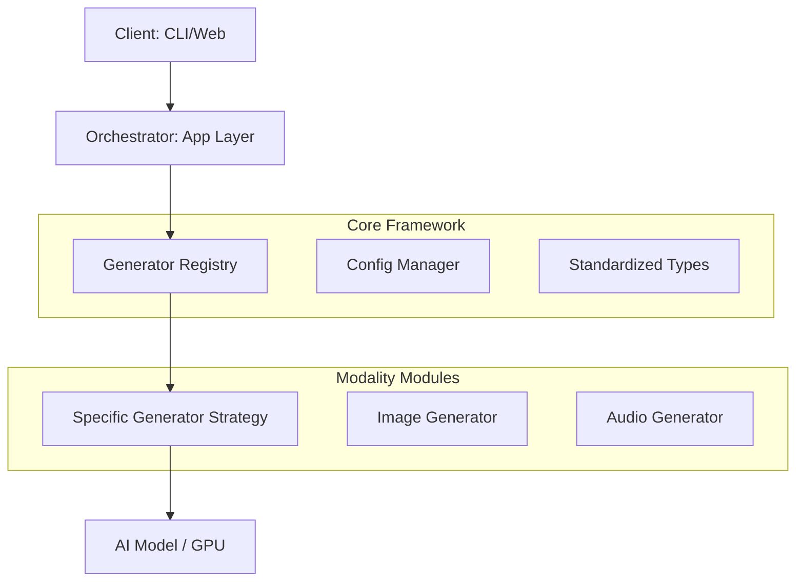
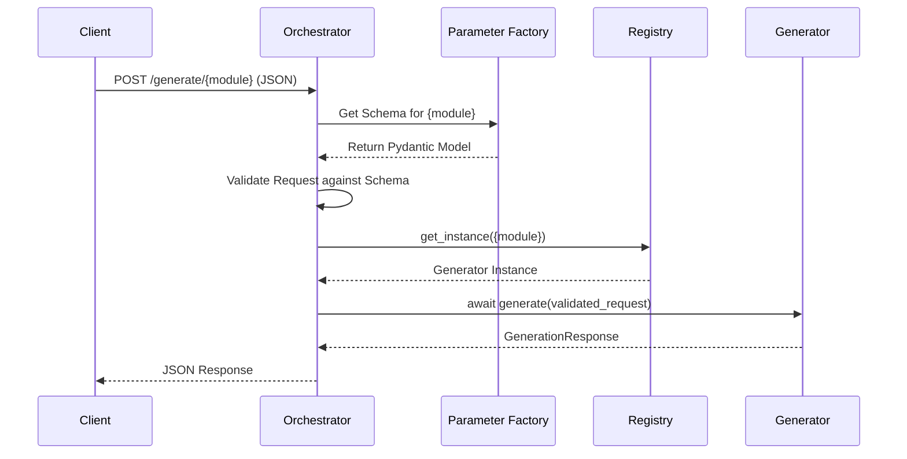

# Architectural Analysis Report: ggena Framework

## 1. Executive Summary
The `ggena` project currently functions as a well-structured prototype that successfully implements a dynamic discovery and registration mechanism for AI generation modalities. It leverages the **Registry** and **Strategy** patterns to decouple the orchestration layer (CLI/Server) from specific generator implementations. While the foundation is solid, transitioning from a "collection of scripts" to a "robust framework" requires addressing type safety, formalizing parameter validation, adopting asynchronous interfaces, and standardizing dependency management.

## 2. Current State Analysis

### 2.1 Architecture Overview
The current architecture follows a modular approach:
- **Orchestrator Layer**: `src/app` (CLI and FastAPI server) manages the lifecycle of requests.
- **Registry Layer**: `src/core/registry.py` acts as a central broker, allowing for dynamic discovery via `pkgutil`.
- **Strategy Layer**: `src/generators` contains modality-specific implementations that adhere to a common interface defined in `BaseGenerator`.

### 2.2 Strengths
- **Dynamic Discovery**: The use of `discover_and_register_generators` allows new modalities to be added with zero changes to the core orchestration logic, provided they follow the registration convention.
- **Singleton Management**: The registry's ability to manage both fresh instances and cached singleton instances is critical for high-performance server environments where model loading is expensive.
- **Standardized Data Transfer**: The use of `GenerationRequest` and `GenerationResponse` dataclasses provides a consistent contract between the orchestrator and generators.

### 2.3 Identified Design Flaws & Weaknesses
| Flaw | Impact | Description |
| :--- | :--- | :--- |
| **Weak Type Enforcement** | High | `BaseGenerator` uses `Any` for request/response types, bypassing the benefits of the standardized dataclasses and increasing risk of runtime errors. |
| **Synchronous Interface** | Medium | The `generate` method is synchronous. While handled by threads in the server, it prevents native async implementations (e.g., for I/O bound generators). |
| **Loose Parameter Validation** | High | Modality-specific parameters are passed as a raw `Dict[str, Any]`. This lacks schema validation and makes the API prone to user error. |
| **Global State Dependency** | Medium | Heavy reliance on global singletons (`config`, `registry`) can make unit testing difficult and complicates dependency injection. |
| **Missing Packaging Standards** | Low | Absence of `pyproject.toml` prevents proper dependency management and standard Python installation/distribution. |

## 3. Proposed Architecture

### 3.1 Refined Pattern Implementation
To achieve enterprise-grade robustness, we should evolve the current patterns:

1.  **Async Strategy Pattern**: Update `BaseGenerator` to use `async def generate(...)`. This allows generators to natively await I/O or GPU operations without thread overhead.
2.  **Command Pattern for Task Execution**: Instead of direct method calls, encapsulate generation tasks into `GenerationCommand` objects. This enables features like task queuing, retries, and audit logging.
3.  **Factory Pattern for Parameter Models**: Use a Factory to return modality-specific Pydantic models based on the requested module, ensuring strict validation before the request reaches the generator.

### 3.2 Improved Type Safety & Validation
We will replace the generic `Dict[str, Any]` with **Pydantic-based schemas**. Each generator will define its own `ParameterSchema`.

```python
class ImageParameters(BaseModel):
    width: int = Field(1024, ge=256, le=4096)
    height: int = Field(768, ge=256, le=4096)
    guidance_scale: float = Field(7.0, ge=1.0, le=20.0)

class ImageGenerator(BaseGenerator):
    async def generate(self, request: GenerationRequest[ImageParameters]) -> GenerationResponse:
        # ... implementation ...
```

### 3.3 Dependency Injection (DI)
Move away from global singletons towards a DI container or passing dependencies through constructors. This allows for easier mocking during testing and better control over resource lifecycles.

## 4. Architectural Diagrams
### 4.1 High-Level Component Interaction


### 4.2 Request Lifecycle (Proposed)


## 5. Concrete Refactoring Roadmap

### Phase 1: Foundation (Immediate)
- [ ] **Standardize Types**: Update `BaseGenerator` to use actual `GenerationRequest` and `GenerationResponse` from `src.core.types`.
- [ ] **Modern Packaging**: Add `pyproject.toml` and migrate dependencies from manual management to a standard tool (e.g., `poetry` or `pip`).
- [ ] **Async Transition**: Convert `BaseGenerator.generate` to an `async` method.

### Phase 2: Robustness (Short-term)
- [ ] **Pydantic Integration**: Implement modality-specific parameter validation using Pydantic models.
- [ ] **Enhanced Error Handling**: Define a custom exception hierarchy (`GgenaError` -> `GeneratorError`, `ValidationError`, etc.).
- [ ] **Dependency Injection**: Refactor `ConfigManager` and `Registry` to support injection into generator constructors.

### Phase 3: Scalability (Long-term)
- [ ] **Command Pattern**: Implement a task queue/command system for handling long-running or batch generation jobs.
- [ ] **Plugin Architecture**: Formalize the discovery mechanism to allow third-party developers to install generators as separate Python packages.

## 6. Future Vision: Supporting 20+ Models
When `ggena` scales to dozens of models, the architecture will behave like a true **Model Hub Orchestrator**:
- **Zero-Touch Integration**: New models are added by simply dropping a new package into the environment; the orchestrator discovers them automatically via entry points.
- **Heterogeneous Resource Management**: The registry can intelligently route requests to different worker nodes (e.g., Image on GPU-A, Audio on CPU-B) based on model requirements.
- **Unified API Surface**: Despite the diversity of underlying models, the client interacts with a single, strictly typed, and highly predictable interface.
