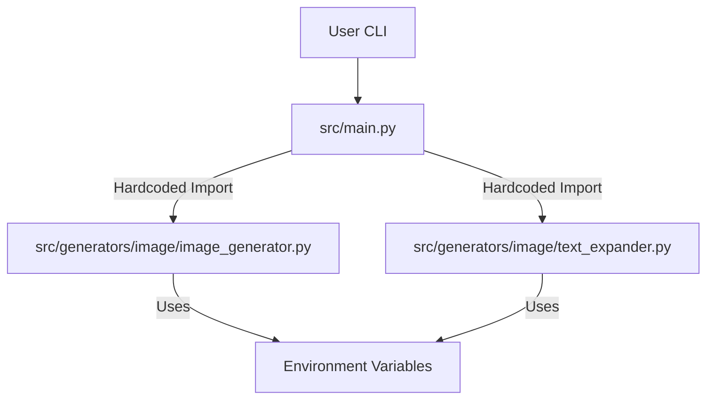
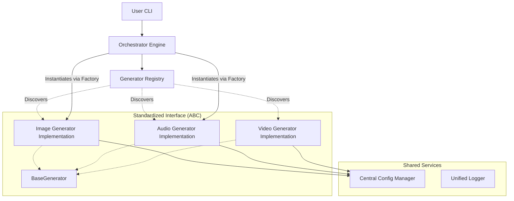

# Architectural Analysis Report: ggena Framework

## 1. Executive Summary

The current `ggena` project functions as a functional AI generation orchestrator, but its architecture is currently characterized by a **script-based procedural approach**. While effective for the initial implementation of image generation, the design lacks the formal patterns required to scale into a robust, extensible framework capable of supporting dozens of diverse modalities (audio, music, video, etc.) without significant technical debt.

This report identifies critical architectural flaws and proposes a transition toward a **Plugin-based Strategy & Registry architecture**.

---

## 2. Current State Analysis ("As-Is")

### 2.1 Identified Design Flaws

| Flaw | Description | Impact |
| :--- | :--- | :--- |
| **Tight Coupling** | `src/main.py` explicitly imports functions from `src.generators.image`. | Adding a new modality requires modifying the core orchestrator code, violating the **Open/Closed Principle**. |
| **Procedural Dispatching** | The orchestrator uses an `if-elif-else` chain to decide which module to run. | As modalities grow, `main.py` becomes a "God Object" that is difficult to maintain and test. |
| **Lack of Interface Contract** | There is no formal definition (ABC) for what constitutes a "Generator". | Different generators may have inconsistent signatures, making automated orchestration impossible. |
| **Fragmented Configuration** | Modules directly access `os.getenv`. | Harder to validate configurations, implement defaults centrally, or support multiple configuration profiles. |
| **Inconsistent Error Handling** | Error handling is implemented locally within each generator function. | The orchestrator cannot provide a unified error reporting or recovery mechanism. |

### 2.2 Current Architecture Diagram (Mermaid)

---

## 3. Proposed Architecture ("To-Be")

### 3.1 Recommended Design Patterns

To achieve scalability and modularity, we will implement the following patterns:

1.  **Strategy Pattern**: Define a strict `BaseGenerator` Abstract Base Class (ABC). Every new modality must implement this interface.
2.  **Registry Pattern**: A central `GeneratorRegistry` where generators "self-register" upon module import. This allows the orchestrator to discover capabilities dynamically.
3.  **Factory Pattern**: The Orchestrator will use the Registry to instantiate the correct Strategy at runtime based on user input.
4.  **Data Transfer Objects (DTOs)**: Use `dataclasses` for standardized `GenerationRequest` and `GenerationResponse` objects to ensure type safety across the pipeline.

### 3.2 Proposed Architecture Diagram (Mermaid)

---

## 4. Refactoring Roadmap

### Phase 1: Foundation (The Core)
- [ ] Create `src/generators/base.py` containing the `BaseGenerator` ABC.
- [ ] Define `GenerationRequest` and `GenerationResponse` dataclasses in `src/core/types.py`.
- [ ] Implement a `GeneratorRegistry` class in `src/core/registry.py`.
- [ ] Create a centralized `ConfigManager` to replace direct `os.getenv` calls.

### Phase 2: Implementation Alignment
- [ ] Refactor `src/generators/image/image_generator.py` to inherit from `BaseGenerator`.
- [ ] Update `text_expander.py` to be a component used by the Image Generator strategy.
- [ ] Ensure all generators return standardized `GenerationResponse` objects.

### Phase 3: Orchestrator Decoupling
- [ ] Rewrite `src/main.py` to use the `GeneratorRegistry`.
- [ ] Remove all direct imports of specific generator modules from `main.py`.
- [ ] Implement a generic CLI that handles any registered modality.

### Phase 4: Expansion & Hardening
- [ ] Add new modalities (Audio, Video) by simply adding new files in `src/generators/` that register themselves.
- [ ] Implement global error handling and logging within the Orchestrator.

---

## 5. Vision for Scale (20+ Models)

When the project reaches a scale of 20+ models, the architecture will support:

1.  **Plugin Discovery**: The orchestrator can scan the `src/generators/` directory and automatically load all available modules without any code changes to the core.
2.  **Heterogeneous Execution**: Different generators can run on different hardware (CPU vs GPU) or even different containers, managed by a unified command interface.
3.  **Standardized Pipeline**: Every model, regardless of complexity, follows the same `Request -> Process -> Response` lifecycle, making it trivial to add monitoring, telemetry, and caching layers globally.
